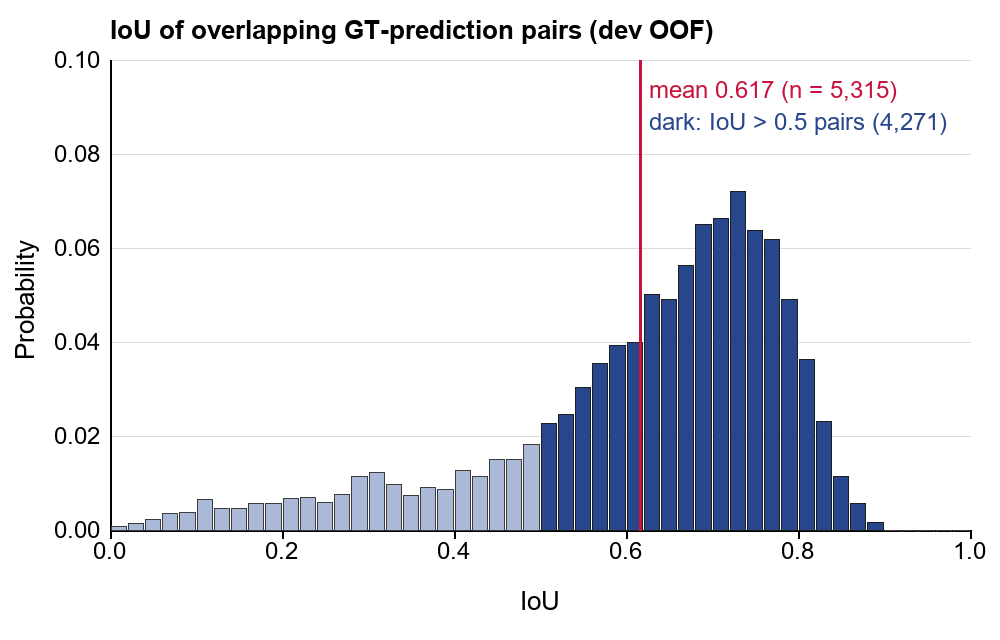
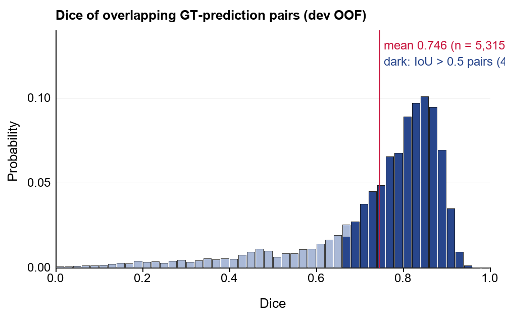
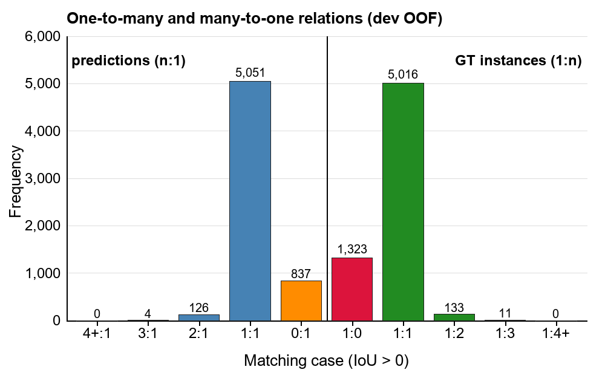

# Evaluation: Dice, IoU and relation distributions

The competition rubric asks for the distributions of Dice and IoU and for the one-to-many and many-to-one relations
between predictions and annotations. This page gives those distributions, and it says exactly which predictions and
which pairs they describe.

A few terms come up throughout:

- **GT** (ground truth) means an annotator's filament polygon. An **annotator record** is one annotator's full set of
  polygons for one image. Some images have more than one record.
- **IoU** is the overlapping area of two masks divided by their combined area. **Dice** is twice the overlapping area
  divided by the sum of the two areas.
- **TP, FP and FN** are true positives, false positives and false negatives. A GT-prediction pair with IoU strictly
  greater than 0.5 is a TP. A prediction with no TP in a record is an FP for that record. A GT with no TP is an FN.
- **PQ** (panoptic quality) is the sum of the IoUs of all TP pairs divided by (TP + FP/2 + FN/2), pooled over all
  annotator records.

## Which predictions these are

The test labels are hidden, so none of these numbers describe test data. They describe the development images instead:
folds 0-3, 566 images, 914 annotator records and 6,483 GT instances.

The predictions are the cross-fitted development analogue of the recipe I submitted. Cross-fitted means that each
fold's images were scored by models trained on the other three development folds, so no scorer saw the images it
scored. The analogue uses the same seeds and the same blend as the submitted recipe (0.7 times the mean of LightGBM
seeds 10-19 plus 0.3 times the mean of ExtraTrees seeds 10-19). It uses the same decision rule too. The score is
s = q - 0.2|t - 0.475|, with a further 0.03 taken off every candidate that isn't a cnx tree node (family 0). Exact
selection then runs at tau 0.24, and the selected tree-node masks (families 0, 5 and 6) get the 0.23 px shift toward
the top of the image.

These are not the predictions of the fitted blend that I shipped. On test, the LightGBM half of the blend was refit on
all 707 images. On development, each fold is scored by models trained on three folds, and the I6 detector columns come
from half-fit models. No stored record held these development masks, so Claude rebuilt them on CPU from the stored
out-of-fold maps and scores. Every rebuilt candidate matched the stored overlap table with a maximum difference of 0
in all four folds. The same code run on a recorded 5-seed score set reproduced that set's stored per-image counts
exactly (PQ 0.470913).

The final development masks are 3,705 predicted instances. Because each image can have several records, they make
6,018 prediction-record pairs, and those pairs are the base for the FP count. The masks are in
[`evaluation/predictions/`](evaluation/predictions/) in the competition's submission format, with one CSV per fold.

## Which pairs these are

I report two pair populations, both pooled over the 914 annotator records:

- **All overlapping pairs:** all 5,315 GT-prediction pairs with IoU > 0.
- **Matched pairs:** the 4,271 pairs with IoU > 0.5. These are the TP pairs that PQ counts. The other 1,044 overlapping
  pairs have an IoU above 0 and at most 0.5.

Objects with no overlap form no pair, so they don't appear in the Dice or IoU histograms. They are not given a score
of 0. They are counted in the relation numbers instead, and they still count against PQ. A GT that overlaps no
prediction is always an FN, and a prediction that overlaps no GT of a record is always an FP for that record.

## Definitions

The definitions come from the organizers' self-evaluation notebook, specifically `get_overlap_matrices`,
`get_pq_score`, `plot_distribution` and `plot_m2n_counts`. For each annotator record, each GT polygon is rasterized on
its own and compared with every predicted instance of the image. The histograms use every pair with a score above 0,
pooled, with 50 bins on [0, 1]. The relation counts use IoU > 0. For each GT they count the overlapping predictions
(1:n). For each prediction they count the record's overlapping GT (n:1), so a prediction is counted once per record of
its image.

The numbers on this page come from the scripts below, which follow those definitions. They are not the output of a
run of the notebook itself. Three things are my additions and are not in the notebook: the matched-pair distributions,
the count of many-to-many components and the bootstrap standard error of PQ.

The hosts have said that the notebook over-counts duplicated masks (host statement 755906). That doesn't arise here,
because the predictions don't overlap each other and no prediction matched two GT at IoU > 0.5.

## Means and medians

| Population | Pairs | IoU mean | IoU median | IoU middle 50% | Dice mean | Dice median | Dice middle 50% |
|---|---|---|---|---|---|---|---|
| All overlapping pairs (IoU > 0) | 5,315 | 0.617 | 0.665 | 0.544-0.741 | 0.746 | 0.798 | 0.705-0.851 |
| Matched pairs (IoU > 0.5) | 4,271 | 0.689 | 0.697 | 0.624-0.756 | 0.812 | 0.821 | 0.768-0.861 |

The mean IoU of the matched pairs is the segmentation quality term of PQ (SQ, 0.6887). The full table is in
[`evaluation/rubric_table.csv`](evaluation/rubric_table.csv) and
[`evaluation/rubric_table.md`](evaluation/rubric_table.md).

## Plots

In both histograms, the light bars show all 5,315 overlapping pairs as a probability per 0.02-wide bin. The dark
overlay is the share of the same bins that comes from the 4,271 matched pairs. The red line is the mean of all
overlapping pairs.

The two text labels at the top right of the Dice plot run off the edge of the image. They read "mean 0.746
(n = 5,315)" and "dark: IoU > 0.5 pairs (4,271)".

The relation chart shows predictions on the left as n:1 and GT instances on the right as 1:n. The bins at 4 or more
are merged, and both of them are 0.

## One-to-many and many-to-one relations

| Overlapping partners (IoU > 0) | 0 | 1 | 2 | 3 | 4 or more | Total |
|---|---|---|---|---|---|---|
| GT instances, by number of overlapping predictions (1:n) | 1,323 | 5,016 | 133 | 11 | 0 | 6,483 |
| Prediction-record pairs, by number of overlapping GT in that record (n:1) | 837 | 5,051 | 126 | 4 | 0 | 6,018 |

The 1,323 GT with no overlapping prediction are 60% of the 2,212 FN. The other 889 FN overlap a prediction, but only
at IoU of at most 0.5. In the same way, 837 of the 1,747 FP overlap no GT in their record, and the other 910 overlap a
GT at IoU of at most 0.5.

There are 7 many-to-many components. A many-to-many component is a connected group in a record's IoU > 0 overlap graph
with at least 2 GT and at least 2 predictions. These are the seven:

| Fold | Image | Annotator record | GT | Predictions | Overlapping pairs | Matched pairs |
|---|---|---|---|---|---|---|
| 0 | 20160310133734Ch | 050103-20160310133734Ch | 2 | 2 | 3 | 0 |
| 1 | 20110918112834Ch | 010102-20110918112834Ch | 2 | 2 | 3 | 2 |
| 2 | 20140210180154Bh | 050102-20140210180154Bh | 2 | 3 | 4 | 1 |
| 3 | 20111114082314Th | 050101-20111114082314Th | 2 | 2 | 3 | 0 |
| 3 | 20111114082314Th | 050102-20111114082314Th | 2 | 2 | 3 | 0 |
| 3 | 20111114082314Th | 050103-20111114082314Th | 2 | 2 | 3 | 1 |
| 3 | 20120703070814Th | 010402-20120703070814Th | 2 | 2 | 3 | 0 |

Three of the seven are the same image in three annotator records, so the seven cover five images in all.

## PQ and its uncertainty

| Measure | Value |
|---|---|
| PQ | 0.4706 |
| Image-bootstrap standard error of PQ | 0.0049 |
| SQ | 0.6887 |
| RQ (recognition quality, TP / (TP + FP/2 + FN/2)) | 0.6833 |
| TP / FP / FN | 4,271 / 1,747 / 2,212 |
| PQ on fold 0 / 1 / 2 / 3 | 0.4815 / 0.4542 / 0.4905 / 0.4578 |

The standard error comes from 2,000 bootstrap draws in which the images were resampled, with all of their records. It
is conditional image-resampling uncertainty. In other words, it holds the whole pipeline fixed and asks how much PQ
would move on a different sample of images. It is not uncertainty over the whole model search. I chose several
constants of this recipe on these same 566 images, and the bootstrap doesn't include that selection, so 0.4706 is
likely somewhat optimistic. For comparison, the public leaderboard score of the submitted recipe was 0.41, on
different images and with the fitted models described above. Seed choice is also a separate and smaller effect: four
5-seed score sets of the same configuration gave PQ from 0.47004 to 0.47071.

## Precision and recall against the fixed-threshold baseline

The baseline is the idea I started from: a ResNet34 U-Net map at a fixed threshold of 0.4, with every connected
component of at least 64 pixels taken as one filament. Precision is TP / (TP + FP) and recall is TP / (TP + FN).

| | TP | FP | FN | Precision | Recall | PQ |
|---|---|---|---|---|---|---|
| Fixed-threshold baseline | 4,718 | 5,566 | 1,765 | 45.88% | 72.77% | 0.383 |
| This recipe (development analogue) | 4,271 | 1,747 | 2,212 | 70.97% | 65.88% | 0.4706 |

Both rows have the same 6,483 GT (TP + FN). The recipe finds 447 fewer matches than the baseline. It gains PQ because
it removes far more false positives than it gives up in matches: 3,819 fewer FP against 447 more FN.

This comparison is descriptive and it is not a paired ablation. The baseline row is a single run from an earlier date
with its own maps and harness, and its threshold was not tuned. Between the two rows, many things changed at once, so
the difference can't be assigned to any single component. The technical report gives the measured contributions of the
individual components, each against its own base.

## Histogram bin counts

These are the counts behind the plots: the number of pairs in each 0.02-wide bin. Each bin includes its lower edge and
excludes its upper edge, except that the last bin includes 1.0. Claude computed them from the same pair tables with the
same bin edges as the plots, and the column totals are 5,315 and 4,271.

A pair with an IoU of exactly 0.5 is not a match, because the rule is strictly greater than 0.5. There is one such
pair, which is why the IoU bin 0.50-0.52 has 121 pairs in all but 120 matched. In terms of Dice, IoU > 0.5 is the same
as Dice > 2/3, so the Dice bin 0.66-0.68 is only partly matched.

| Bin | IoU, all pairs | IoU, matched pairs | Dice, all pairs | Dice, matched pairs |
|---|---|---|---|---|
| 0.00-0.02 | 4 | 0 | 2 | 0 |
| 0.02-0.04 | 7 | 0 | 2 | 0 |
| 0.04-0.06 | 12 | 0 | 4 | 0 |
| 0.06-0.08 | 19 | 0 | 5 | 0 |
| 0.08-0.10 | 20 | 0 | 6 | 0 |
| 0.10-0.12 | 34 | 0 | 7 | 0 |
| 0.12-0.14 | 24 | 0 | 10 | 0 |
| 0.14-0.16 | 24 | 0 | 14 | 0 |
| 0.16-0.18 | 30 | 0 | 12 | 0 |
| 0.18-0.20 | 30 | 0 | 20 | 0 |
| 0.20-0.22 | 36 | 0 | 16 | 0 |
| 0.22-0.24 | 37 | 0 | 18 | 0 |
| 0.24-0.26 | 31 | 0 | 14 | 0 |
| 0.26-0.28 | 40 | 0 | 19 | 0 |
| 0.28-0.30 | 60 | 0 | 23 | 0 |
| 0.30-0.32 | 65 | 0 | 17 | 0 |
| 0.32-0.34 | 52 | 0 | 22 | 0 |
| 0.34-0.36 | 39 | 0 | 28 | 0 |
| 0.36-0.38 | 48 | 0 | 25 | 0 |
| 0.38-0.40 | 46 | 0 | 27 | 0 |
| 0.40-0.42 | 67 | 0 | 26 | 0 |
| 0.42-0.44 | 61 | 0 | 38 | 0 |
| 0.44-0.46 | 80 | 0 | 48 | 0 |
| 0.46-0.48 | 80 | 0 | 57 | 0 |
| 0.48-0.50 | 97 | 0 | 51 | 0 |
| 0.50-0.52 | 121 | 120 | 32 | 0 |
| 0.52-0.54 | 131 | 131 | 44 | 0 |
| 0.54-0.56 | 161 | 161 | 43 | 0 |
| 0.56-0.58 | 188 | 188 | 56 | 0 |
| 0.58-0.60 | 209 | 209 | 58 | 0 |
| 0.60-0.62 | 212 | 212 | 74 | 0 |
| 0.62-0.64 | 266 | 266 | 87 | 0 |
| 0.64-0.66 | 261 | 261 | 101 | 0 |
| 0.66-0.68 | 299 | 299 | 133 | 95 |
| 0.68-0.70 | 346 | 346 | 143 | 143 |
| 0.70-0.72 | 352 | 352 | 198 | 198 |
| 0.72-0.74 | 383 | 383 | 239 | 239 |
| 0.74-0.76 | 339 | 339 | 258 | 258 |
| 0.76-0.78 | 329 | 329 | 347 | 347 |
| 0.78-0.80 | 261 | 261 | 358 | 358 |
| 0.80-0.82 | 193 | 193 | 472 | 472 |
| 0.82-0.84 | 123 | 123 | 515 | 515 |
| 0.84-0.86 | 60 | 60 | 536 | 536 |
| 0.86-0.88 | 30 | 30 | 503 | 503 |
| 0.88-0.90 | 8 | 8 | 368 | 368 |
| 0.90-0.92 | 0 | 0 | 184 | 184 |
| 0.92-0.94 | 0 | 0 | 49 | 49 |
| 0.94-0.96 | 0 | 0 | 6 | 6 |
| 0.96-0.98 | 0 | 0 | 0 | 0 |
| 0.98-1.00 | 0 | 0 | 0 | 0 |

## How these were made, and the local paths in the scripts

Claude wrote and ran the scripts on CPU on 2026-11-06. They are copied into
[`evaluation/scripts/`](evaluation/scripts/) unchanged, so they still hold the local paths of my working folder:

- `rubric_dev.py` rebuilds the masks of one fold and writes its pair table. Its paths point to
  `D:/FilamentSegmentationKaggle/claude` and `D:/FilamentSegmentationKaggle/data`, specifically the stored out-of-fold
  maps, the stored reference counts, the training annotations and the split file. It also imports a frozen analysis
  module, `work/ideas15/hyg/hyg_read.py`, which loads the stored scorer outputs, and it checks that module's hash when
  it runs.
- `rubric_combine.py` pools the four pair tables and draws the tables and plots. It reads and writes under
  `D:/FilamentSegmentationKaggle/claude/work/package/report_inputs/rubric`, and it loads the Arial fonts from
  `C:/Windows/Fonts`. The plots are drawn with Pillow in the layout of the notebook's plots.
- `run_rubric.sh` starts `rubric_dev.py` on the four folds as four CPU processes, using the same local folder and a
  local Python at `D:/FilamentSegmentationKaggle/claude/.venv-cpu`.

The working folder, `hyg_read.py` and the pair tables (`pairs_f<k>.npz`) are not part of this release, so the scripts
are here as a record of exactly what was computed and they won't run from a fresh clone. The scripts hold no
credentials.
